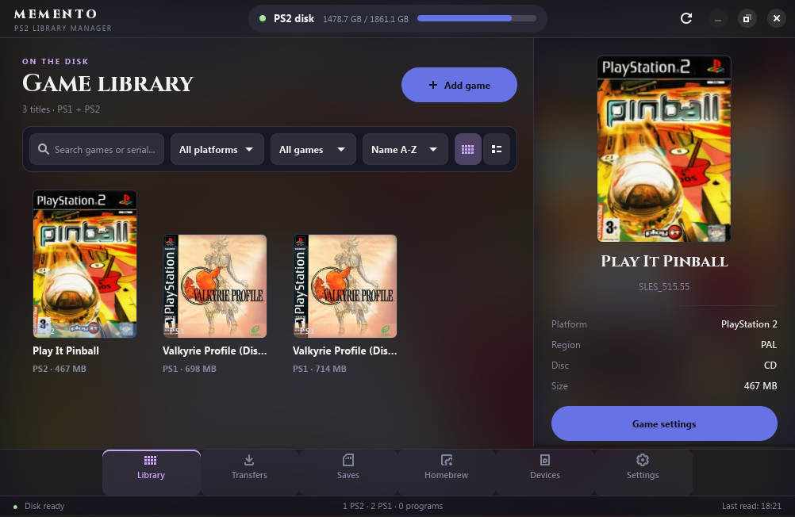

# Memento

A desktop app (GTK4 / libadwaita, written in C) to manage the games on a **PS2 hard disk or SSD** from your PC, for the
OPL / POPStarter way of playing: install and remove PS2 and PS1 games, covers and art, cheats, per-game settings,
homebrew, and a check of your disc images against the Redump lists.



> Files, folders and commands inside the project are still called `ps2gm`; the program is Memento (the name is one
> line, `APP_NAME` in `src/ui/app.h`).

Memento contains no games and does not help find any. You need your own, legally obtained disc images.

## What it does

- **SD cards and USB drives (MX4SIO, USB)**: besides a PS2 hard disk or SSD, Memento can work on a mounted drive that has OPL's folder
  layout (`DVD/`, `CD/`, `ART/`, `CFG/`, `CHT/`, `VMC/`, `POPS/`, `APPS/`): choose it on the Devices tab (drives mounted under
  `/run/media` that look like one are listed, or press **Choose folder...**). Everything works as on the disk (install, remove, art,
  cheats, settings, memory cards, PS1 games, homebrew) on plain files, with no administrator password. Games are named the way OPL
  expects (`SLUS_123.45.Title.iso`, `.zso` too). A FAT32 card cannot hold a file of 4 GiB or more (Memento says so; use a `.zso` or
  an exFAT card); OPL's split `ul.cfg` format is not supported. Tried on a real MX4SIO with an exFAT microSD: OPL lists the games (set OPL's
  "BDM Start Mode" to Auto and leave Settings with OK so it is saved).
- **Library**: the covers (or a list) of what is on the disk, with search, filters (platform, with cheats, missing cover),
  sorting, and a details panel for the selected game: platform, region, disc, size, game settings, pictures, cheats, remove.
- **Add game**: install a PS2 `.iso` or `.zso` (HDL game for OPL), or PS1 BIN/CUE (converted to a POPStarter `.VCD`;
  several discs become a multi-disc game, with an optional shared memory card). Drag and drop works. Choose or drop **several** PS2 images at once and they become a list (games already on the disk,
  repeated games and files that are not PS2 images are shown and left out); each one is then installed as its own transfer. You choose the cover
  from a carousel (flat, 3D box, archive, or your own picture) before it is installed.
- **Transfers**: installs run in the background, one at a time. Queue several, keep using the program, cancel a waiting one
  (or a running one while it still prepares the image); a notification appears when a long queue ends.
- **Check the image**: compares the MD5 of an `.iso` (or the BIN files of a PS1 game) with the Redump lists of good dumps.
  The lists are downloaded once (Settings, or the first check) and then used offline. PS2 CDs that Redump keeps as several
  tracks, and `.zso` files, cannot be checked this way.
- **ZSO**: read straight from a `.zso`; keep it compressed on the disk (needs an OPL with ZSO support) or unpack it while
  installing; compress an `.iso` while installing, with an estimate of the saving first. `build/ps2gm-ziso pack|unpack|estimate|info`
  does the same from the command line. (`hdl_dump` loses the end of a ZSO that is not a whole number of 2048-byte
  sectors, so Memento pads a copy of such files first.)
- **Art**: covers, back covers, icons, logos, backgrounds and screenshots as **PNG** (OPL only reads PNG), written into
  `+OPL/ART` together with `CFG/<ID>.cfg`. Free space of `+OPL` is checked first.
- **Cheats**: edit a game's cheat list (`+OPL/CHT/<ID>.cht`, checked the way OPL reads it) and switch the cheat engine on.
- **Game settings** (PS2): compatibility modes, disk speed (DMA), forced video mode (GSM), alternative startup file,
  written into the game's `.cfg`; other lines of the file are kept.
- **Saves**: the virtual memory cards in `+OPL/VMC` on the disk (or any raw `.bin` card on this computer, for example on a USB
  stick): list the saves with their titles, export one as `.psu`, import `.psu` files, delete a save, save a copy of the card.
  A card of the disk is copied to this computer, changed there and put back safely (written beside the old card, checked by
  size, then it replaces it), and a backup of the card is kept before every change (the last five, in
  `~/.local/share/ps2gm/vmc-backups`). Only raw cards without ECC are supported, like the ones OPL creates. The card code
  is in `src/core/mcfs.c` (portable C, tested on the PC with synthetic cards).
- **PS1 fixes**: for a PS1 game, edit the `CHEATS.TXT` that POPStarter reads from the game's folder in `__common/POPS`: switches for
  a few documented workarounds (`$CACHE1`, `$SUBCDSTATUS`, `$CODECACHE_ADDON_0`, `$UNDO_GAME_FIXES`) and a box for any other
  line (other `$` settings, raw cheat codes). These settings come from the community's POPStarter documentation, so test one
  change at a time. The same dialog copies `TROJAN_#.BIN` / `PATCH_#.BIN` fix files (from a fix pack you have) into the game's
  folder and removes them again; nothing is downloaded.
- **Removing a PS1 game** also removes the launcher file POPStarter made for it. A tick box in the question also deletes its memory card,
  settings and fix files (the saves on the card are lost); it is off by default, and a folder that another disc uses as its shared
  card, or that holds anything unknown, is never deleted.
- **Homebrew**: the programs on the `APPS` partition (as in OPL's Apps tab): add an `.ELF` (checked to really be one),
  update one while keeping the old version as `NAME-OLD.ELF`, rename, remove.
- **Devices / Settings**: connect or disconnect the disk and see what is on it; language; the Redump lists; credits.

Works with the standard layout only: `+OPL/ART`, `+OPL/CFG`, `+OPL/CHT`, `__.POPS/<ID>.<Title>.VCD`,
`__common/POPS/<VCD name>/`, `APPS`. To start PS1 games from OPL's own menu you need an OPL build that lists `__.POPS`; otherwise start POPStarter another way (for example from a launcher such as wLaunchELF).

## Languages

English, Italiano, Español, Français, Deutsch, Português (Brasil). The program follows the system language; Settings
chooses another one (effective at the next start). All translations were produced with an AI assistant and have not been
reviewed by native speakers (the author reads Italian), so corrections are very welcome (`po/<lang>.po`, how-to in
`docs/LAYOUT.md`).

## Build and run

Needs: a C compiler, meson, ninja, libadwaita (>= 1.7, which brings GTK 4), libcurl, gdk-pixbuf, liblz4, zlib, fontconfig,
gettext (`msgfmt`), and `pkexec` (polkit) at run time.

```sh
scripts/dev-run.sh        # builds, links the tools next to the app, starts it
scripts/install.sh        # for your user only (~/.local): program, icon and menu entry; the disk then needs setfacl, see below
scripts/install.sh --system  # for all users in /usr/local (sudo): this one can use the password window
scripts/uninstall.sh      # removes it again
```

For the password window to work, install for all users: `scripts/install.sh --system` (or a distribution package, see
`docs/PACKAGING.md`: Gentoo, Arch and Nix recipes are in `packaging/`). The disk helper runs as root **only** from files that
belong to root; a copy in your home folder is refused, and then needs the `setfacl` way below.

`tools/bin` holds `hdl_dump` and `pfsshell` (versions in `tools/VERSIONS.txt`; `scripts/build-tools.sh` rebuilds them).
Plug the PS2 drive into the PC, press **Connect** on the Devices tab, and give your administrator password once: the disk
is only ever touched by `ps2gm-helper`, started through `pkexec`. If no password window appears, your desktop session has
no polkit agent; give your user access once instead (`sudo setfacl -m u:$USER:rw /dev/sdX`) and connect again.

## Safety

The helper has a fixed command set and checks everything again: the device must have an APA partition table (a PS2 disk);
it writes only to `+OPL/ART|CFG|CHT|VMC` (the VMC folder takes only files that start like a memory card image), `__.POPS` (root), `__common/POPS/<one folder>` and the root of `APPS`; a game is
removed only if exactly one installed game matches **both** its ID and its title; names with quotes, backslashes or line
breaks are refused; a program is accepted only if it is a real ELF. While a transfer runs, everything else that would use
the disk is refused. Even so: keep a backup of anything you cannot lose, and try on a spare disk first.

## Code map

`docs/LAYOUT.md` says which file does what, and where to change colors, sizes and texts.

## Tests

```sh
tests/run_tests.sh [path/to/psx-vcd]
```

Everything runs on a throw-away disk **image file** (never a real drive): the disk tool wrappers, the helper protocol
(including every refusal), the library, the install and remove workflows, ZSO packing/unpacking (every index shift, damaged
files must fail cleanly), the Redump lists, and the VCD converter byte for byte against the reference tool. The art
download part needs the network. For manual checks without clicking, `PS2GM_SCRIPT` accepts steps such as
`connect=<image>;page=add;shot=a.png;quit` (see `src/ui/script.c`).

## License

GPL-3.0-or-later (`LICENSE`): you may change and share Memento, and a version you distribute must stay open under the same
license. Third-party material and licenses: `NOTICE.md`.
